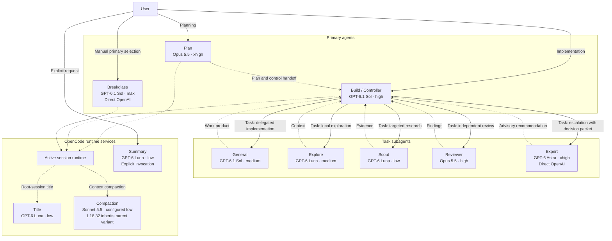

# OpenCode multi-model routing starter

This bundle routes OpenCode's built-in agents through one configuration file and adds four custom agents: the subagents `reviewer`, `expert` and `scout`, and `breakglass`, a custom primary agent that a human selects and no agent may dispatch. It targets OpenCode 2.x; the OpenCode 1.x bundle is kept as history (see "OpenCode 1.x (history)" below).

Routing is split deliberately into two layers:

- `v2/opencode.jsonc`: deterministic model, variant and mode assignment per agent, and the permission rules.
- `v2/.opencode/model-routing.md`: semantic rules telling the controller when Superpowers work should go to `general`, `reviewer`, `expert` or `scout`.

The routing policy is loaded through OpenCode's `instructions` setting; it does not need to be merged into the project's `AGENTS.md`.

> **Which version is this?** The sections up to "OpenCode 1.x (history)" describe
> OpenCode 2.x, the current target. Everything after that heading describes the
> frozen 1.x bundle and is kept as history.

## OpenCode 2 (current)

The 2.x bundle lives under `v2/`:

```text
v2/opencode.jsonc                          routing authority: model, agents, permissions
v2/.opencode/agents/{reviewer,expert,scout}.md   prompts and non-routing metadata
v2/.opencode/model-routing.md              the routing policy, loaded through `instructions`
v2/manifests/current-routing-targets.json  roles, models, variants, forbidden references
```

The adapter is `eval/runtime/opencode-v2-adapter/`. The workflow, in order. All
commands run from the repository root. Paths under `~/.config/opencode` assume
`XDG_CONFIG_HOME` is unset; if it is set, use `$XDG_CONFIG_HOME/opencode` instead.

1. **Convert once.** Turn an existing 1.x config into the 2.x shape. Upstream
   offers no non-interactive converter, so this uses OpenCode 2's own
   translation in a sandbox, backs up the input, and prints a `dropped:` line
   for everything 2.x cannot carry.

   ```bash
   bash models/routing/opencode/eval/runtime/opencode-v2-adapter/convert-v1-config.sh \
     --input ~/.config/opencode/opencode.jsonc --output ~/.config/opencode/opencode.jsonc \
     --in-place --backup-root ~/.local/state/opencode-routing/backups
   ```

2. **Activate.** Writes only the routing-owned keys into the global config and
   refuses a 1.x-shaped file, a symlink, or a directory holding both
   `opencode.json` and `opencode.jsonc`. `--dry-run` runs those checks and prints
   only `dry_run=1`, the `target` and its `before_sha256`; it writes nothing and
   does not show a diff. Copy the contents of `v2/.opencode/` (`agents/` and
   `model-routing.md`) into the config root first, so `model-routing.md` exists at
   the absolute path you pass. Alignment compares the installed files there, and
   expects `model-routing.md` at `<config-root>/model-routing.md`: activation
   writes the path normalised and warns when it is anywhere else or missing. An
   undeclared variant on a model the target's `providers` block declares is
   refused; a provider block with no entry for the model (such as the
   converter's `"openai": {}`) is not checked statically, only noted, and the
   verifier checks it against `/api/model`.

   ```bash
   cp -r models/routing/opencode/v2/.opencode/. ~/.config/opencode/
   bash models/routing/opencode/eval/runtime/opencode-v2-adapter/activate-profile.sh \
     --profile models/routing/opencode/v2/opencode.jsonc \
     --targets models/routing/opencode/v2/manifests/current-routing-targets.json \
     --config-root ~/.config/opencode --backup-root ~/.local/state/opencode-routing/backups \
     --model-routing ~/.config/opencode/model-routing.md
   ```

3. **Check alignment.** Files only: does the installed configuration still match
   this bundle? Exit `0` aligned or stale (prose only), `1` drift, `2` usage or
   nothing installed. It reports and never repairs.

   ```bash
   bash models/routing/opencode/eval/check-alignment.sh
   ```

4. **Verify against the server.** Asks the running server what each role
   resolves to (provider, model, variant, mode, the `subagent` deny on
   Breakglass, forbidden references) and writes `effective-routing.json`. Add
   `--project-cwd DIR` to see project overrides, and `--call` to run each role
   once. `--call` starts the `opencode` client, so it must be on `PATH`, or
   set `OPENCODE_BIN` to it (the vendor installer puts it in
   `~/.opencode/bin/opencode`, which a non-interactive shell may not have on
   `PATH`). `--credentials` is a dotenv file holding `OPENCODE_PASSWORD` or
   `OPENCODE_SERVER_PASSWORD`; it reaches curl through stdin, never argv.
   `--server` defaults to `http://127.0.0.1:4096` (the probe below too). Use a
   fresh directory for `--neutral-cwd`, so that no project config above it
   can change what the server resolves, and for `--outdir`, so the result is not
   mixed with an older run:

   ```bash
   work=$(mktemp -d)
   bash models/routing/opencode/eval/runtime/opencode-v2-adapter/verify-effective-routing.sh \
     --server http://127.0.0.1:4096 \
     --credentials ~/.config/opencode-runtime/secrets.env \
     --targets models/routing/opencode/v2/manifests/current-routing-targets.json \
     --outdir "$work/out" --neutral-cwd "$work"
   ```

5. **Probe Breakglass.** It must resolve as a primary agent with the manifest's
   model, and no other agent may be able to dispatch it. Writes `breakglass.json`.

   ```bash
   work=$(mktemp -d)
   bash models/routing/opencode/eval/runtime/opencode-v2-adapter/probe-breakglass.sh \
     --server http://127.0.0.1:4096 \
     --credentials ~/.config/opencode-runtime/secrets.env \
     --targets models/routing/opencode/v2/manifests/current-routing-targets.json \
     --outdir "$work/out" --cwd "$work"
   ```

**Agents load lazily per directory.** The first lookup of an agent can miss, so
every lookup against a server polls until the agent resolves, bounded at 30 s
(`V2_AGENT_POLL_TIMEOUT`, default `30`). A one-shot request that misses is not
evidence the agent is absent.

## V2 profile format

This is the contract a private profile generator targets: produce a file of this
shape plus a targets manifest, and the tools above work on it unchanged.

- **Routing-owned keys**, the only ones activation writes and alignment compares:
  top-level `model`; `agents.<role>` for every role the manifest declares (each
  row replaced whole); the top-level `permissions` entries whose `action` is
  `subagent`; and exactly one `instructions` entry, the absolute path of the
  installed `model-routing.md`. Everything else is yours and is never reported,
  except that alignment reports DRIFT when the top-level entry deciding a
  subagent call to Breakglass (the last `subagent` or `*` entry matching it) is
  not a deny.
- **Targets manifest**, format `opencode-v2-routing-targets/1`: `profile_id`,
  `default_model`, `agents.<role>` rows of `{providerID, model, variant, mode}`,
  `breakglass: {agent, deny_as_subagent}` (`deny_as_subagent` must be `true`:
  the tools always require the deny and never read it as permission to drop
  it), `forbidden_model_references`, and
  `forbidden_effective_state`. A role's `mode` of `null` means the mode is not
  checked, for roles that keep whatever mode the server gives them.
- **The prompt key is `system`.** `prompt` is the 1.x name: in a 2.x file it is
  silently dropped, so the agent runs without its prompt. In agent markdown the
  body becomes `system`.
- **Permissions are an ordered list** of `{action, resource, effect}`; the last
  match wins. The 1.x action names change in two places: `bash` becomes `shell`
  and `task` becomes `subagent`. Every other action keeps its name.
- **Markdown never carries `model`.** `.opencode/agents/*.md` hold prompts and
  non-routing metadata; the model is assigned only in `opencode.jsonc`. The
  frontmatter does carry the agent's `permissions` (same list shape as above),
  and alignment treats any frontmatter difference as `DRIFT`; a difference in the
  body is only `STALE`.
- **No 1.x top-level key** (`agent`, `provider`, `permission`, `plugin`,
  `disabled_providers`, `autoupdate`, `server`, or an `mcp` object without
  `servers`) may appear in a file these tools write. A file mixing both shapes
  silently loses settings upstream.

## Removed in V2

- **`temperature`.** An agent-level value is not sent at all on 2.x. It was also
  already meaningless for this bundle's models: every routed role runs a
  reasoning model with an effort set, Anthropic's Fable 5.x models reject
  `temperature`, and OpenAI reasoning models do not honour it. Effort is the
  lever for review depth. The converter removes it and reports it as `dropped:`.
- **A provider's `blacklist` and `whitelist`.** 2.x drops both and has no
  equivalent. A provider whose models exist only by declaration does not
  expose a model you did not declare, so for those the rule is: **a model you
  must not use is a model you do not declare.** It does not extend to a built-in
  provider, which ships its own model catalog and keeps its models usable
  whether or not you declare them. `forbidden_model_references` in the manifest
  guards only the models the routed roles actually resolve to; it does not stop
  anyone selecting another model by hand.

## OpenCode 1.x (history)

The 1.x bundle is frozen: the root `opencode.jsonc` and `.opencode/`, `profiles/`,
and the adapter at `eval/runtime/opencode-v1-adapter/`. It is kept as the record
of how routing was built and measured. **Do not run the 1.x adapter against a
2.x host**: it reads and writes a shape 2.x ignores or mangles. The sections
below describe that bundle.

### Model map

| Role | OpenCode agent | Model | Variant |
|---|---|---|---|
| Planning/design | `plan` | `github-copilot/claude-opus-5.5` | `xhigh` |
| Primary build/controller | `build` | `github-copilot/gpt-6.1-sol` | `high` |
| Delegated implementation/debugging | `general` | `github-copilot/gpt-6.1-sol` | `medium` |
| Local codebase exploration | `explore` | `github-copilot/gpt-6-luna` | `medium` |
| External/upstream research | `scout` | `github-copilot/gpt-6-luna` | `low` |
| Independent review | `reviewer` | `github-copilot/claude-opus-5.5` | `high` |
| Escalation-only expert | `expert` | `openai/gpt-6-astra` | `xhigh` |
| Human-only breakglass | `breakglass` | `openai/gpt-6.1-sol` | `max` |
| Context compaction | `compaction` | `github-copilot/claude-sonnet-5.5` | `low` |
| Session title | `title` | `github-copilot/gpt-6-luna` | `low` |
| Session summary | `summary` | `github-copilot/gpt-6-luna` | `low` |

`opencode.jsonc` is the single authority for role-to-model assignment.
`.opencode/agents/reviewer.md`, `.opencode/agents/expert.md` and
`.opencode/agents/scout.md` define prompt, permissions and non-routing metadata
only; they carry no `model` or `variant`.

`breakglass` is human-selected primary. Ordinary agents cannot reach it: the
`task` permission denies it explicitly, at the top level and on every agent that
can delegate. `hidden` is not treated as a security property anywhere in this
bundle.

Build and Reviewer use different model families. Expert stays on the existing
direct OpenAI subscription connection; normal work stays on Copilot. Plan now
shares Opus 5.5 with Reviewer. All permissions and Breakglass boundaries remain
unchanged.

The [2026-10-03 current routing alignment](docs/decisions/2026-10-03-current-routing-alignment.md)
records the active user selection. It is an operational routing choice, not a
claim of general model superiority.
`eval/manifests/current-routing-targets.json` declares the current targets; the
default model follows Build (Copilot GPT-6.1 Sol). The decision record states
the evidence boundary for substitutions without new successful-call or
role-fixture evidence, including the unverified direct OpenAI Astra inference
and Expert-role fitness exception.

[`observe/`](observe/) contains the read-only, post-hoc observer for the current
profile's operational observation period. It produces metadata-only reports in
user state outside the repository, includes Task children, separates eval
dispatchers from production sessions, and requires human confirmation before
applying trigger thresholds. Its README defines the weekly review and privacy
boundary.

### Agent interaction

This diagram shows the intended policy flow with Build as the controller, not
measured session traffic or an automatic dispatch schedule. All models are on
GitHub Copilot unless marked as direct OpenAI. Solid arrows show task assignment
or delegation; dashed arrows show handoffs, returned results, or runtime services.



- **Plan to Build is a handoff**, not an automatic Task invocation. Plan and
  General also have Task permissions; the diagram focuses on the Build-led flow.
- **Reviewer and Expert return assessments.** Expert does not implement changes;
  the calling controller retains decision and implementation responsibility.
- **Breakglass is human-selected only.** Task delegation to it is denied.
- **Title and Compaction are runtime services**, not ordinary controller Task
  calls, and can serve primary agents other than Build. Task children do not
  generate automatic titles in OpenCode 1.18.32.
- **Compaction variant inheritance is a known deviation** in OpenCode 1.18.32:
  configured `low` does not govern the inherited variant on that path. See the
  [append-only alignment addendum](docs/decisions/2026-10-03-current-routing-alignment.md#addendum--2026-10-04-compaction-variant-inheritance).
- **Automatic snapshot summaries do not invoke Summary.** The configured Summary
  model is available through explicit invocation.

### Routing migration

The historical OpenCode V1 multi-model routing restoration was governed by:

- [Approved routing plan](docs/decisions/2026-09-02-multi-model-routing-v3.4.3.md)
- [First implementation actions](docs/runbooks/2026-09-02-migration-first-actions.md)

The decision document is the source of truth for migration gates,
evaluation rules, recovery constraints, and model-routing decisions.

The [Phase-R ground-truth readiness record](docs/evidence/2026-09-03-phase-r-ground-truth-readiness.md)
adds the approved exact Scout `low` and Compaction `medium` variants, executable
Reviewer/Explore/Compaction fixture ground truth, and the user-global activation
contract. It does not change or activate the published routing profile.

Phase R is **`PASS`**, as of the
[2026-09-04 scope amendment](docs/decisions/2026-09-04-phase-r-scope-amendment.md)
— see the
[Phase-R execution evidence](docs/evidence/2026-09-04-phase-r-execution.md)
for the full record. The amendment separates restoration (is this routing
operationally viable?) from optimization (is each model the best choice for
its role?): Build, Explore, Compaction, routing resolution and security
boundaries passed and were not re-run to reach this status; the Reviewer
5/5 seeded-defect + clean-zero benchmark (see I1/I2, the
[Reviewer fixture-integrity remediation](docs/evidence/2026-09-04-reviewer-fixture-integrity-remediation.md),
and the
[Reviewer observability/attribution remediation](docs/evidence/2026-09-04-reviewer-observability-attribution-remediation.md))
is **reclassified** — unchanged threshold, fixture, and scorer — from a
Phase-R restoration gate to targeted Phase-3 quality evidence; historical
runs remain inadmissible for quality adjudication. Phase R instead gates
Reviewer's *operational integration* (model resolution, routing,
permissions, successful dispatch, adapter/output-path traversal, no
security regression), fully evidenced without any new live dispatch. The
routing profile was restored and activated on the real, user-global OpenCode
configuration and became the historical
`canonical_quality_reference` — meaning restoration-quality, not a claim
that every role's model is optimal for its role.

#### Phase-3 Build optimization cycle: closed, KEEP_OPUS

Two hypothesis-driven Build challenger experiments have completed against
the restored baseline — Opus 5 high vs Sonnet 5 high
(`docs/decisions/2026-09-04-phase3-build-ab-result.md`) and Opus 5 high vs
GPT-5.6 Sol high (`docs/decisions/2026-09-04-phase3-build-gpt-result.md`) —
both concluding **KEEP_OPUS**. At that closure, Build remained Opus 5 high and
Reviewer remained Copilot Sol high. The Reviewer-inversion path those experiments gated was
**NOT_TRIGGERED** (its prerequisite, a Build Sol win, did not occur) and is
not pre-registered or executed. The later user selection is separate from those
benchmark decisions and does not rewrite their results. Full closure record, including the scoped
Sol conclusion, preserved budget history, and the observation-driven policy
now governing future experiments:
[Phase-3 Build optimization cycle closure](docs/decisions/2026-09-04-phase3-build-optimization-closure.md).

### Restored reference profile

[`profiles/v1-restored-2026-09.jsonc`](profiles/v1-restored-2026-09.jsonc) is
the historical canonical restored V1 baseline, not the current selection.
It remains the reference for the recorded Phase-3 experiments; see the header in that
file for the full amended-gate provenance.

[`profiles/baseline-2026-08.jsonc`](profiles/baseline-2026-08.jsonc) remains
the preserved, untouched historical record of the pre-Phase-R profile.

### Capability status (Track A)

The [2026-09-02 capability closure](docs/evidence/2026-09-02-capability-closure.md)
found that the committed Claude Opus 4.6 targets failed the runtime capability
check in the audited environment: the explicit model ID was not resolvable.
The same check found the old Claude Sonnet 4.6 ID was not resolvable.

GPT-5.3-Codex resolves in the audited environment as of the recorded
capability check. This is discovery evidence only; the closure does not claim
that a Codex request executed successfully. The migration away from Codex is
an explicit risk decision, not a capability finding.

Use this evidence hierarchy before activating a profile:

```text
documentation / policy
    -> candidate information

opencode models
    -> discovery / resolution signal

successful trivial call
    -> usable capability

role fixture
    -> routing fitness
```

The organization policy page is authoritative for policy state, not runtime
capability state.

The [governance blocker record](docs/evidence/2026-09-02-governance-blockers.md)
records the resolved local Copilot, OpenAI, and OpenCode V2 RFC ownership
decisions and distinguishes external organizational controls.

### Phase 0 evaluation harness

Run the dependency-free Phase 0 gate tests from the repository root:

```bash
bash models/routing/opencode/eval/run-tests.sh
```

The harness is evidence infrastructure only. It does not install or activate a
routing profile, call candidate models during tests, or authorize Phase R. See
the [Phase 0 gate record](docs/evidence/2026-09-02-phase-0-gates.md) for the
implemented gates and unresolved budget inputs.

For future isolated capability probes, use an **experiment-only primary agent**
with the intended model and verified role permissions, preserving and checking
active Title/Summary routing. As of OpenCode 1.18.32, isolating XDG configuration
can lose the explicit title model; a direct `--model` override then selects the
provider used by title fallback. `--model` alone does not override a configured title model.
The Breakglass completion is an example of an experiment-only primary. Record
auxiliary provider streams and unknown costs separately from primary dispatch
accounting. See the [title-provider diagnostic](eval/records/title-provider-check-2026-10/result.md)
for the configured Build→Expert path and its evidence boundaries.

### Alignment check (1.x, historical)

The 1.x checker is `eval/runtime/opencode-v1-adapter/check-alignment.sh`. It
compares an installed 1.x configuration (top-level `permission.task`, agent rows,
`permission:` frontmatter) with the frozen root bundle, and is not run against a
2.x host. The command `eval/check-alignment.sh` now checks the 2.x bundle; see
"OpenCode 2 (current)", step 3.

### 1. Verify model IDs and variants

Connect GitHub Copilot and OpenAI in OpenCode, then inspect the models and variants available to your accounts:

```text
/connect
/models
/variants
```

Or list models from the CLI where appropriate:

```bash
opencode models
```

Do not assume a model ID in this historical profile is currently available.
The capability closure above found that `github-copilot/claude-opus-4.6` was
not resolvable in the audited environment. In that audit,
`github-copilot/gpt-5.3-codex` was listed as a discovery signal only.

For any profile you activate, verify the configured model IDs against the
installed runtime and then confirm usable capability with a trivial successful
call:

```text
github-copilot/claude-opus-5.5
github-copilot/claude-sonnet-5.5
github-copilot/gpt-6-luna
github-copilot/gpt-6.1-sol
openai/gpt-6.1-sol
openai/gpt-6-astra
```

Variant availability can depend on the provider/model catalog exposed to your installation. Verify `low`, `medium`, `high`, `xhigh`, and `max` as applicable before merging. If a requested variant is not exposed, use the highest available variant for that model without changing the role mapping.

### 2. Enable web search

The bundle enables the `websearch` permission so agents can search the web via Exa AI. The tool requires the `OPENCODE_ENABLE_EXA` environment variable to be set:

```bash
export OPENCODE_ENABLE_EXA=true
```

Add this to your shell profile (`~/.bashrc`, `~/.zshrc`, etc.) for persistence. No API key is required — the tool connects directly to Exa AI's hosted MCP service without authentication.

If you use the [agentic-dev-toolkit installer](../../../environments/linux/install.sh), this variable is set automatically in the managed `~/.bashrc` block.

### 3. Install the custom agents and routing policy

Copy these files from this bundle into the matching target paths.

For a **project-local** install, keep the `.opencode/` prefix:

```text
.opencode/agents/reviewer.md -> <project>/.opencode/agents/reviewer.md
.opencode/agents/expert.md   -> <project>/.opencode/agents/expert.md
.opencode/agents/scout.md    -> <project>/.opencode/agents/scout.md
.opencode/model-routing.md   -> <project>/.opencode/model-routing.md
```

For a **user-global** install the files sit directly under the OpenCode
config directory, with no `.opencode/` segment — this is the layout the
alignment check inspects:

```text
.opencode/agents/reviewer.md -> ~/.config/opencode/agents/reviewer.md
.opencode/agents/expert.md   -> ~/.config/opencode/agents/expert.md
.opencode/agents/scout.md    -> ~/.config/opencode/agents/scout.md
.opencode/model-routing.md   -> ~/.config/opencode/model-routing.md
```

`reviewer` is independent and read-only on Copilot Opus 5.5/high. `expert` uses
direct OpenAI Astra/xhigh, is hidden, read-only, cannot spawn subagents, and is
capped at six agentic steps. `scout` is a subagent for external research: it may
fetch and search the web but cannot edit, run commands or spawn subagents, and it
cites a URL for every claim. Build uses Copilot GPT-6.1 Sol/high; Breakglass uses
direct OpenAI GPT-6.1 Sol/max as a human-selected primary.

These are copies. After installing them — and after any later change to
either side — [the alignment check](#alignment-check-1x-historical)
tells you whether they still match this bundle.

### 4. Merge the OpenCode configuration

Merge `opencode.jsonc` into your existing project or global OpenCode configuration. Treat it as a fragment and do not replace unrelated configuration.

If your existing configuration already has an `instructions` array, append the
routing policy without replacing the existing entries. In a project-local
installation use `.opencode/model-routing.md`. In a user-global installation
use the absolute path to `~/.config/opencode/model-routing.md` (expanded to the
actual home directory): the project-relative path does not resolve to the
user-global support file. `activate-profile.sh` converts the legacy relative
entry in an existing global config to the absolute installed path.

The fragment pins all eleven roles as follows:

```text
plan       -> Claude Opus 5.5 (Copilot)   xhigh
build      -> GPT-6.1 Sol (Copilot)       high
general    -> GPT-6.1 Sol (Copilot)       medium
explore    -> GPT-6 Luna (Copilot)        medium
scout      -> GPT-6 Luna (Copilot)        low
reviewer   -> Claude Opus 5.5 (Copilot)   high
expert     -> GPT-6 Astra (direct OpenAI) xhigh
breakglass -> GPT-6.1 Sol (direct OpenAI) max
compaction -> Claude Sonnet 5.5 (Copilot) low
title      -> GPT-6 Luna (Copilot)        low
summary    -> GPT-6 Luna (Copilot)        low
```

It also permits `plan`, `build`, and `general` to invoke subagents via the Task
tool, with `breakglass` explicitly denied at every one of those `task`
permission blocks and at the top level.

### 5. Superpowers routing

`.opencode/model-routing.md` provides the semantic mapping:

```text
Superpowers implementation subagent -> general    -> GPT-6.1 Sol medium (Copilot)
Superpowers review / re-review       -> reviewer   -> Claude Opus 5.5 high (Copilot)
high-risk / disputed judgment        -> expert     -> GPT-6 Astra xhigh (direct OpenAI)
```

This layer is still an instruction to the controller, not a hard-coded Superpowers dispatcher. The deterministic parts are the agent-to-model mapping. If future observation shows Superpowers repeatedly dispatching review to the wrong subagent, the next escalation is a minimal Superpowers dispatch override rather than adding more prompt rules.

### 6. Why no AGENTS.md fragment

OpenCode supports project instruction files directly through the `instructions` field in `opencode.json`. Keeping the routing policy in `.opencode/model-routing.md` avoids mixing personal orchestration policy with the repository's general engineering rules in `AGENTS.md`.

Your existing `AGENTS.md`, if any, remains untouched and is still loaded by OpenCode alongside the configured instruction file.

### 7. Smoke tests

After merging the configuration, verify these scenarios:

1. Ask `build` to locate a local implementation before editing. Expected helper: `explore`.
2. Ask for comparison with current upstream/dependency documentation. Expected helper: `scout`.
3. Give a bounded multi-file implementation task. Expected delegated worker when delegation is useful: `general`.
4. Run a Superpowers task review. Expected reviewer: `reviewer`, not `general`.
5. Present an unresolved public API or security decision. Expected escalation: `expert` with a compact decision packet and no implementation by the expert.
6. Confirm `build` can invoke `general`, `explore`, `scout`, `reviewer`, and `expert` through Task.

### 8. GPT-5.6 quota rule

Do not switch `plan`, `build`, `general`, `explore`, `scout`, `reviewer`, `compaction`, `title`, or `summary` to direct OpenAI for normal work; all nine stay on GitHub Copilot. Keep direct OpenAI isolated behind `expert` and the human-selected `breakglass` agent so ordinary delegation cannot accidentally inherit the scarce, credential-gated provider.
